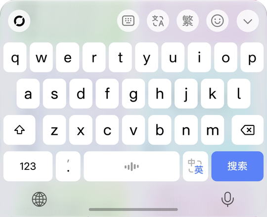
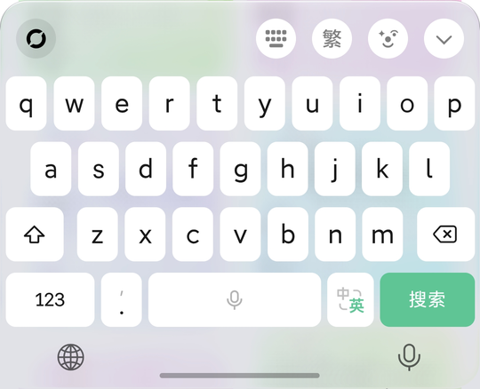
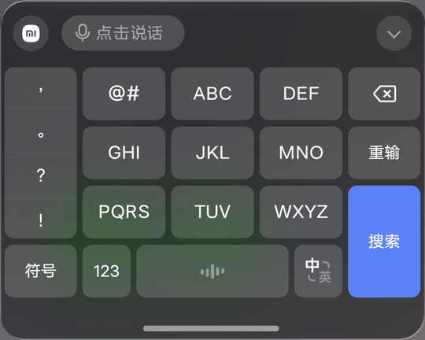
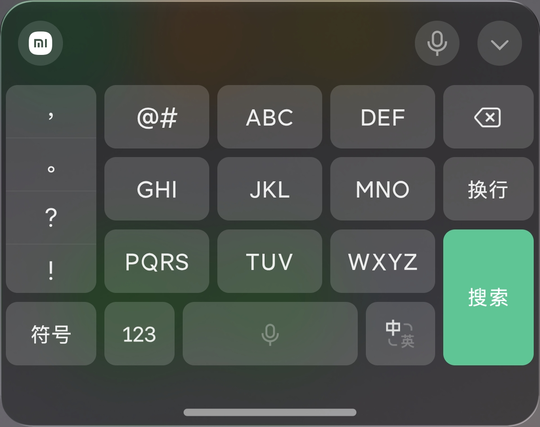

# MOS Liquid Input (MOS液态输入)

**System glass material for the WeChat IME and Doubao IME keyboards, with iOS 26 key colors**

English | [中文](README.md)

  

## Screenshots

| | Doubao IME | WeChat IME |
|---|---|---|
| **Honor MagicOS 11** light |  |  |
| **Xiaomi HyperOS 4** dark |  |  |

## Supported systems

| System | Keyboard material | Notes |
|---|---|---|
| Honor **MagicOS 11** | ✨ Liquid glass | Blur, refraction and edge highlight adjustable in settings |
| Xiaomi **HyperOS 4** | ✨ Liquid glass | Uses the system's built-in glass presets (light and dark) |
| OPPO / OnePlus / realme **ColorOS 17** | 🧊 Frosted glass | ColorOS has no liquid-glass API; uses Android's region background blur |
| Other Android 12+ systems | 🧊 Frosted glass | Should work as long as window blur is enabled |

**Supported IMEs**: WeChat IME (微信输入法) and Doubao IME (豆包输入法), each switchable on its own.

**Framework**: rooted phones use **LSPosed** (API 101 or later, recommended); without root, patch the IME with **NPatch**.

## Features

- **Glass keyboard**: the keyboard background becomes the system glass with rounded top corners; pop-up panels (function menu, emoji page, hold-to-talk) share the same glass.
- **iOS 26 colors**: white keys on light gray in light mode, gray keys on dark gray in dark mode; one key color, no outlines or shadows.
- **Doubao matched to WeChat**: key and candidate text size and weight match WeChat IME, with tighter candidate spacing; optionally use WeChat IME's Latin font.
- **Brand logo**: the top-left button shows the phone brand's mark (Honor ring / Xiaomi / OPPO).
- **Honor only**
  - **Keyboard haptics**: normal keys, space, delete and press-and-hold delete use Honor's keyboard-tuned haptic effects.
  - **Navigation-bar voice key**: a microphone on the right of the navigation bar; tap or hold to talk.
  - **Home-screen search**: the keyboard matches the search panel's color and fills the width.
- **Live tuning**: every parameter is adjustable in the settings page, and most changes apply immediately.

## Install

### Option 1: root + LSPosed (recommended)

1. Install the module APK.
2. Enable "MOS液态输入" in LSPosed and tick **WeChat IME** and/or **Doubao IME** in its scope.
3. Open "MOS液态输入", tap **重启输入法** (restart IME), then tap the test field. If the keyboard turns into glass, it works.

### Option 2: without root (NPatch)

[NPatch](https://github.com/7723mod/NPatch) is a root-free Xposed framework: it injects the module loader into the IME's APK and re-signs it (Android 9 or later).

> [!WARNING]
> - The patched IME is signed differently, so **you must uninstall the original IME first**. Its local dictionary, settings and sign-in are wiped; back them up first.
> - The patched IME may not be able to sign in or sync its dictionary. Typing itself usually works.
> - The patched IME **cannot be updated from an app store**; patch the new APK again after each IME update.
> - Only patch the IME on your own phone for your own use. Do not share patched APKs.

<b>Show install steps</b>

1. Download and install the NPatch manager from [NPatch Releases](https://github.com/7723mod/NPatch/releases/latest).
   On first launch it asks for "read app list" and "storage access" ("all files access" on ColorOS); grant them.
2. Install the module APK.
3. In the NPatch manager, pick **WeChat IME** or **Doubao IME** and patch it in **local mode**. Start with the default signature-bypass level and raise it only if needed.
   You can also patch on a computer: `java -jar jar-v1.1.0-857-release.jar --manager -l 2 base.apk` (`base.apk` is the IME's APK pulled from the phone; `-l 2` is the signature-bypass level).
4. Uninstall the original IME and install the patched APK.
5. In NPatch, go to "管理 → 应用" (Manage → Apps), tap the patched IME → "模块作用域" (module scope), tick "MOS液态输入" and confirm.
6. Re-enable and switch to this IME in system settings.
7. Use the IME once in any text field (it shows the IME's own user agreement; choose as you wish).
8. Open "MOS液态输入" and tap the test field to see the result.

<b>Known limits without root</b>

- The settings page only connects after the patched IME has run once; until then the keyboard uses the default iOS style and setting changes don't apply.
- NPatch's **integrated mode** (module embedded into the IME) also works, but the settings page can't reach the IME, so only the defaults apply, and changing or updating the module means patching again.
- **ColorOS** freezes the NPatch manager in the background. After ticking the scope for the first time or updating the module, open NPatch in the foreground, then tap "restart IME". After that the module loads from NPatch's cache and NPatch doesn't need to stay open.
- Without root the only way to restart an IME by hand is "force stop", and ColorOS then switches the default IME away; switch it back in system settings.

## Settings page

The settings page is in Chinese only.

| Section | Contents |
|---|---|
| Main card | Master switch, restart IME, test field |
| IMEs | Separate switches for WeChat IME and Doubao IME |
| Style | iOS style (default), high readability, more transparent |
| Common | Background opacity, keyboard corner radius, key corner radius, iOS key colors, brand logo, navigation-bar voice key, Honor keyboard haptics |
| Advanced | Blur, saturation, light/dark tint, remove the IME's own background, key opacity and brightness, Doubao using WeChat's Latin font, pinyin row position, glass texture (refraction, thickness, depth, dispersion, edge highlight), fill in home-screen search |

The settings page only shows the options that work on your phone; see "How do the three systems differ?" below.

## FAQ

<b>A setting didn't take effect?</b>

Tap "restart IME" in the settings page, then tap the text field again.

<b>The keyboard didn't change at all?</b>

- LSPosed: make sure the module is enabled, the IME is in its scope and LSPosed is running, then tap "restart IME".
- NPatch: make sure the module is ticked in that IME's "module scope" in NPatch; on ColorOS, open NPatch in the foreground before restarting the IME.

<b>How do the three systems differ?</b>

| Setting | MagicOS 11 | HyperOS 4 | ColorOS 17 |
|---|---|---|---|
| Keyboard material | Liquid glass | Liquid glass | Frosted glass (no refraction) |
| Background opacity, tint, blur | ✅ | — (set by system presets) | ✅ |
| Saturation | ✅ | — | — |
| Refraction, thickness, depth, dispersion | ✅ | — | — |
| Edge highlight | ✅ | ✅ | ✅ |
| Corner radii, key colors, key brightness, logo, Doubao font, pinyin row position | ✅ | ✅ | ✅ |
| Navigation-bar voice key, haptics, home-screen search | ✅ | — | — |

Options marked "—" are hidden from the settings page on that system.

On ColorOS, when the system turns window blur off (battery saver, for example), the keyboard falls back to a translucent tint.

<b>Gray blobs show through behind the keyboard?</b>

That is the UI behind the keyboard showing through the glass. Raise "blur" in Advanced settings to even it out.

<b>How do I get the original keyboard back?</b>

Turn off the master switch and tap "restart IME", or uninstall the module or remove it from the LSPosed scope. If you used NPatch, uninstall the patched IME and reinstall the original.

## Disclaimer

- This module changes how third-party IMEs look and may stop working after an IME or system update. Use at your own risk.
- The module has **no network permission** and collects, stores and uploads no data.
- This project is not affiliated with Honor, Xiaomi, OPPO, Tencent or ByteDance. MagicOS, 荣耀 and HONOR are trademarks of Honor Device Co., Ltd.; 小米, Xiaomi and HyperOS are trademarks of Xiaomi; OPPO, 一加, OnePlus, realme and ColorOS are trademarks of their respective owners; WeChat IME (微信输入法) and Doubao IME (豆包输入法) are products of their respective owners.

## License

[Apache License 2.0](LICENSE) · Third-party code: [NOTICE](NOTICE) · Build from source: [BUILD.md](BUILD.md) (in Chinese)

Author: 熠寻 (Coolapk @熠寻)
