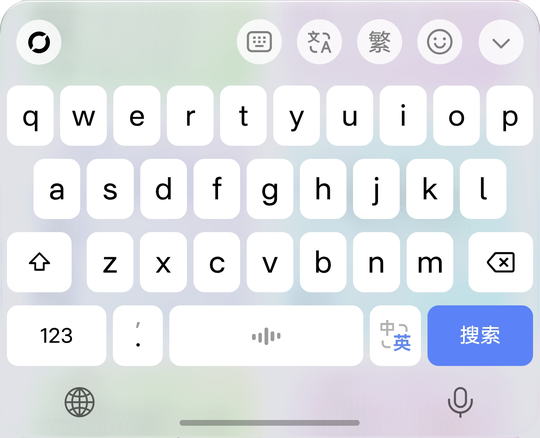
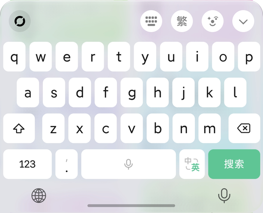
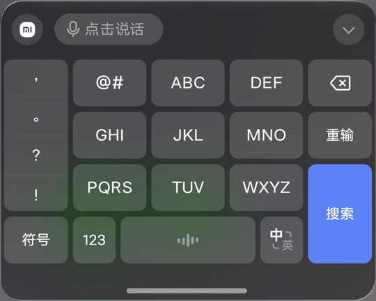
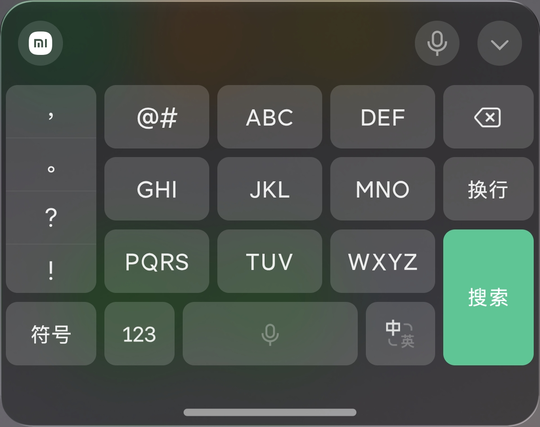

# MOS液态输入

**让微信输入法、豆包输入法的键盘用上系统玻璃材质，按键配色对照 iOS 26**

[English](README.en.md) | 中文

  

## 截图

| | 豆包输入法 | 微信输入法 |
|---|---|---|
| **荣耀 MagicOS 11** 浅色 |  |  |
| **小米 HyperOS 4** 深色 |  |  |

## 支持的系统

| 系统 | 键盘效果 | 说明 |
|---|---|---|
| 荣耀 **MagicOS 11** | ✨ 液态玻璃 | 模糊、折射、玻璃边缘都能在设置页调 |
| 小米 **HyperOS 4** | ✨ 液态玻璃 | 用系统自带的玻璃预设，浅色、深色各一套 |
| OPPO / 一加 / realme **ColorOS 17** | 🧊 毛玻璃 | ColorOS 没有液态玻璃接口，用安卓自带的区域背景模糊 |
| 其他安卓 12+ 系统 | 🧊 毛玻璃 | 系统开着窗口模糊就行，理论上可用 |

**支持的输入法**：微信输入法、豆包输入法（可以分别开关）。

**需要的框架**：已 root 用 **LSPosed**（API 101 及以上，推荐）；没有 root 用 **NPatch** 修补输入法。

## 功能

- **玻璃键盘**：键盘背景换成系统玻璃，顶部圆角；功能菜单、表情页、按住说话等弹出面板和键盘是同一块玻璃。
- **iOS 26 配色**：浅色白键配浅灰底，深色灰键配深灰底，按键同色、没有描边和阴影。
- **豆包对齐微信**：按键和候选字的大小、粗细调成和微信一样，候选词间距收紧；可选用微信输入法的英文字体。
- **品牌 logo**：左上角显示手机品牌标识（荣耀圆环 / 小米 / OPPO）。
- **荣耀专属**
  - **键盘振感**：普通键、空格、删除、长按连删各用荣耀为键盘调的振感。
  - **导航栏语音键**：导航栏右侧的话筒，点按或按住说话。
  - **桌面下拉搜索**：键盘和搜索框外圈同色、铺满，连成一整块。
- **实时调整**：所有参数都能在设置页调，大部分改了马上生效。

## 安装

### 方式一：root + LSPosed（推荐）

1. 安装模块 APK。
2. 在 LSPosed 里启用「MOS液态输入」，作用域勾选**微信输入法**和/或**豆包输入法**。
3. 打开「MOS液态输入」，点 **重启输入法**，再点一下试用输入框。键盘变成玻璃就说明生效了。

### 方式二：免 root（NPatch）

[NPatch](https://github.com/7723mod/NPatch) 是不需要 root 的 Xposed 框架，把模块加载器打进输入法的安装包里，重新签名后安装（要求 Android 9 及以上）。

> [!WARNING]
> - 修补版签名和原版不同，**必须先卸载原版输入法**，本地词库、设置、登录状态都会被清空，请先备份。
> - 修补版可能无法登录账号或同步词库，打字本身一般不受影响。
> - 修补版**不能通过应用商店更新**，输入法更新后要重新修补。
> - 只修补自己手机上的输入法自己用，不要分享修补后的安装包。

<b>展开安装步骤</b>

1. 从 [NPatch Releases](https://github.com/7723mod/NPatch/releases/latest) 下载并安装 NPatch 管理器。
   第一次打开会要求「读取应用程序列表」和「存储空间访问」（ColorOS 上是「所有文件访问」）权限，按提示授予。
2. 安装模块 APK。
3. 在 NPatch 管理器里选择**微信输入法**或**豆包输入法**，用**本地模式**修补。签名绕过等级先用默认值，不行再往上调。
   也可以在电脑上修补：`java -jar jar-v1.1.0-857-release.jar --manager -l 2 base.apk`（`base.apk` 是从手机导出的输入法安装包，`-l 2` 是签名绕过等级）。
4. 卸载原版输入法，安装修补后的安装包。
5. 在 NPatch 的「管理 → 应用」里点修补后的输入法 →「模块作用域」，勾选「MOS液态输入」并确认。
6. 在系统设置里重新启用并切换到这个输入法。
7. 在任意输入框里先用一次这个输入法（会弹出输入法自己的用户协议，按你的意愿选择）。
8. 打开「MOS液态输入」，点一下试用输入框看效果。

<b>免 root 的已知限制</b>

- 设置页要在修补后的输入法运行过一次以后才能连上；没连上时键盘用默认的 iOS 风格，改设置不生效。
- NPatch 的**集成模式**（模块直接打进输入法）也能用，但模块的设置页连不到输入法，只能用默认效果，更换或升级模块都要重新修补。
- **ColorOS** 会冻结后台的 NPatch 管理器：第一次勾选作用域或更新模块后，先把 NPatch 打开放在前台，再点「重启输入法」。之后模块会从 NPatch 的缓存加载，不用一直开着。
- 没有 root 时只能用「强行停止」重启输入法，ColorOS 会顺手把默认输入法换掉，要在系统设置里换回来。

## 设置页

| 分组 | 内容 |
|---|---|
| 主卡片 | 总开关、重启输入法、试用输入框 |
| 输入法 | 微信输入法 / 豆包输入法 分别开关 |
| 风格 | iOS 风格（默认）、高可读、更通透 |
| 常用 | 背景不透明度、键盘圆角、按键圆角、iOS 按键配色、品牌 logo、导航栏语音键、荣耀键盘振感 |
| 高级设置 | 模糊强度、饱和度、浅色/深色底色、去掉输入法自带底板、按键不透明度和亮度、豆包用微信的英文字体、拼音行位置、玻璃质感（折射、厚度、深度、色散、边缘高光）、桌面搜索里铺满 |

设置页只显示当前手机上起作用的项，各系统的差别见下面「三个系统上的效果有什么不同」。

## 常见问题

<b>改了设置没有生效？</b>

点设置页的「重启输入法」，再重新点一下输入框。

<b>键盘完全没有变化？</b>

- LSPosed：确认模块已启用、输入法在作用域里、LSPosed 在运行，然后点「重启输入法」。
- NPatch：确认 NPatch 里这个输入法的「模块作用域」勾选了本模块；ColorOS 上先把 NPatch 打开放在前台，再重启输入法。

<b>三个系统上的效果有什么不同？</b>

| 设置项 | MagicOS 11 | HyperOS 4 | ColorOS 17 |
|---|---|---|---|
| 键盘材质 | 液态玻璃 | 液态玻璃 | 毛玻璃（不折射） |
| 背景不透明度、底色、模糊强度 | ✅ | —（由系统预设决定） | ✅ |
| 饱和度 | ✅ | — | — |
| 折射、厚度、深度、色散 | ✅ | — | — |
| 边缘高光 | ✅ | ✅ | ✅ |
| 圆角、按键配色、按键亮度、logo、豆包字体、拼音行位置 | ✅ | ✅ | ✅ |
| 导航栏语音键、键盘振感、桌面搜索里铺满 | ✅ | — | — |

标「—」的项在对应系统的设置页里不显示。

ColorOS 上系统关掉窗口模糊时（比如省电模式），键盘会退回成半透明底色。

<b>键盘后面透出一团团灰色？</b>

那是键盘后面的界面透过玻璃显示出来了。在「高级设置」里把「模糊」调大就会变均匀。

<b>怎么恢复原来的键盘？</b>

关掉总开关，点「重启输入法」；或者卸载模块、在 LSPosed 里取消作用域。用 NPatch 修补的，卸载修补版、重新安装原版输入法即可。

## 免责声明

- 本模块会修改第三方输入法的显示效果，可能因输入法或系统更新而失效，使用风险自负。
- 模块**没有联网权限**，不收集、不保存、不上传任何数据。
- 本项目与荣耀、小米、OPPO、腾讯、字节跳动均无关联。MagicOS、荣耀、HONOR 是荣耀终端有限公司的商标；小米、Xiaomi、HyperOS 是小米集团的商标；OPPO、一加、OnePlus、realme、ColorOS 是其各自所有者的商标；微信输入法、豆包输入法分别是其所有者的产品。

## 许可证

[Apache License 2.0](LICENSE) · 第三方代码说明见 [NOTICE](NOTICE) · 从源码构建见 [BUILD.md](BUILD.md)

作者：酷安@熠寻
